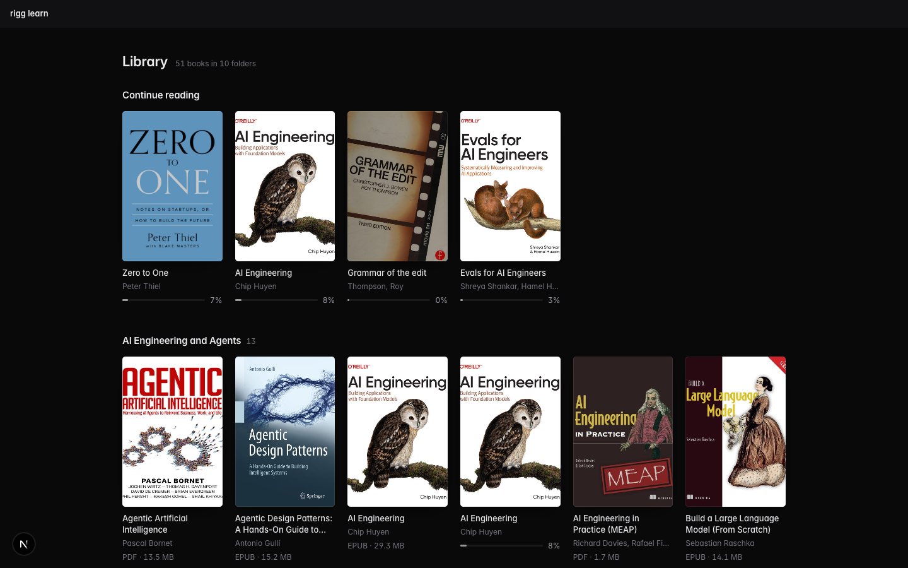
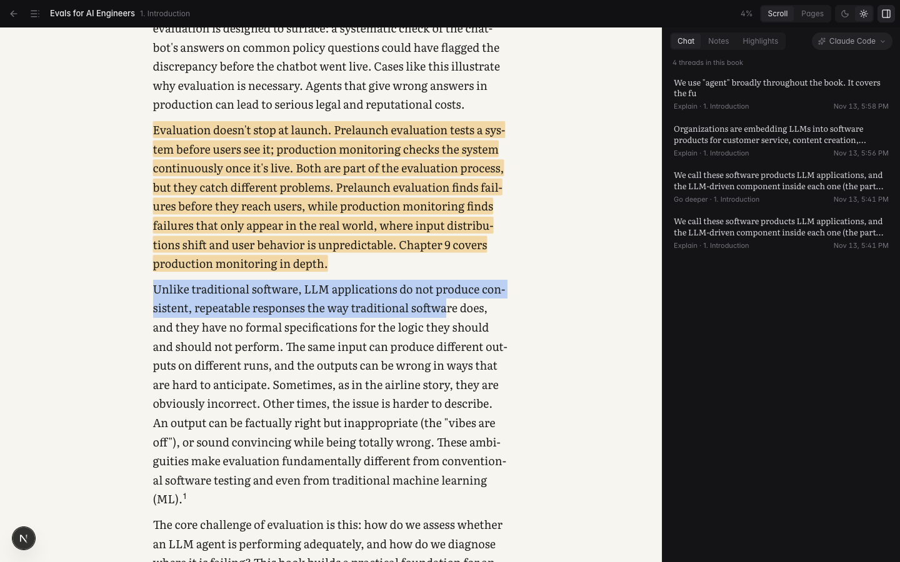

# rigg learn

Read your own EPUB and PDF books with an AI tutor beside you.

Select a passage and ask the tutor to explain it, go deeper, or answer a question. Highlight what matters. Write notes in markdown. Everything you save is also copied to a markdown file, so your notes show up in Obsidian.

The app runs on your own computer. Your books stay there.




| Chapters beside the book | PDF with highlights and a note |
| --- | --- |
|  |  |



## What you need

- [Node.js 22](https://nodejs.org). Check with `node --version` in a terminal.
- A folder of EPUB or PDF books. Subfolders are fine.
- One tutor. See [Pick a tutor](#pick-a-tutor).

## Set it up

1. Open a terminal in this folder.

2. Install what the app needs.

   ```bash
   npm install
   ```

3. Make your own settings file from the example.

   ```bash
   cp .env.example .env.local
   ```

4. Open `.env.local` in a text editor. Put in the full path to your books folder. Paths start with `/`.

   ```bash
   BOOKS_DIR=/Users/you/Books
   NOTES_DIR=/Users/you/Obsidian/Reading
   ANTHROPIC_API_KEY=
   ```

The app only reads `BOOKS_DIR`. It never moves, renames or changes your books.

`.env.local` is private. Git ignores it, so your paths and key are never committed.

## Send your notes to Obsidian

Set `NOTES_DIR` to a folder inside your Obsidian vault, such as `Reading`. The app makes the folder if it is missing.

Each book gets one file, named after its title. Highlights sit under their chapter. Each one is a quote with a block id, so you can link to it from your other notes. A note sits under the quote it belongs to. Any `#tag` you write in a note is added to the file's tags.

```markdown
## Considerations

> and then fine-tuning your model later to boost its performance and provide more consistent, reliable outputs. ^h-c64781df

Fine-tuning only pays off once you have the data. #training
```

The file is a copy. The app writes it again after every change, so edits you make in Obsidian are replaced. Change highlights and notes in the app.

Leave `NOTES_DIR` empty if you don't want a copy. Everything is still saved in the app.

## Pick a tutor

The tutor can run through any one of these. You only need one.

- **Claude Code.** Install [Claude Code](https://claude.com/claude-code), then run `claude` in a terminal once and sign in. It uses your Claude plan.
- **Codex.** Install the Codex CLI, then run `codex login` in a terminal and sign in.
- **Anthropic API.** Put your key after `ANTHROPIC_API_KEY=` in `.env.local`. You pay per use.

Pick one from the menu at the top of the Chat tab. The menu says which ones are ready, and what to do for the rest. The app remembers your choice.

## Start it

```bash
npm run dev
```

Then open [http://localhost:3000](http://localhost:3000). Your books are listed by folder, with their covers. The ones you read last sit under Continue reading. A bar under each book you've started shows how far you are.

Stop the app with `Ctrl+C` in the terminal.

## Read

- **Ask the tutor.** Select text. A small toolbar appears. Choose Explain, Go deeper or Ask. Go deeper asks you one question first, so you can try before it explains. Say "just tell me" to skip it.
- **Show the tutor an image.** Paste one with `⌘V`, drop it on the chat, or choose the image button in the message box. A message can carry up to 4 PNG, JPEG, WebP or GIF images. Ask about them, or send them alone and the tutor explains them. Images work in a follow-up on a passage, and in the box under the list of threads, where you can also ask about the book without selecting anything. Click an image in the chat to see it larger.
- **Highlight.** Select text and choose the highlighter, or press `⌘⇧H`. Click a highlight to remove it or open its note.
- **Write a note.** Select text and choose the notebook button. Notes are markdown. `⌘↩` saves.
- **Find them again.** The Notes and Highlights tabs list everything for the book. Click a quote to jump to it.
- **Chapters.** The list button at the top left, or `⌘⇧L`, opens the table of contents in a column beside the book. The book makes room for it and keeps your place. The chapter you're in is marked. Click any chapter to go there. In a narrow window the list slides over the book instead.
- **Scroll or pages.** Switch at the top right. Pages shows one page at a time, or two side by side in an EPUB when there's room. Turn pages with the arrow keys, `Page Up` and `Page Down`, or the arrows at the edges. Your place is kept when you switch, and the app remembers your choice.
- **Where you are.** A thin bar along the bottom of the book shows how far through it you are. Click or drag it to jump, or focus it and use the arrow keys. Under it are the page and the percent. An EPUB shows its printed page number when the book has one, and otherwise its location, a fixed slice of the text. In Pages view the middle says how many pages are left in the chapter, when the book's files make that clear.
- **Page colours.** In an EPUB, **Aa** at the top right switches between a dark page and a warm light one. Only the page changes; the app around it stays dark. Your place is kept. In a PDF, the moon at the top right shows white pages dark and the sun shows them in their own colours. Photos keep their colours.
- **Bold starts.** In an EPUB, choose Bold starts under **Aa** and the first letters of each word turn bold, in the style of Bionic Reading®. Some people find it helps them keep their place, but studies so far haven't found that it makes reading faster. Your place and your highlights stay put when you switch. Code is left alone, and so is Chinese, Japanese, Korean and Thai text.
- **Font.** **Aa** also lists the fonts on your Mac, each name in its own face, with a few faces made for reading at the top. Hover over a font, or move to it with the arrow keys, to see the book in it. Click it or press `Return` to keep it, or press `Esc` to go back. Reset to Literata returns to the default. Code stays in a monospaced face, and if a font you chose is removed from your Mac, the book goes back to Literata. PDFs keep their own fonts.
- **More room.** `⌘\` hides or shows the side panel. `Esc` closes the toolbar.

A PDF made of scanned pictures has no text to select. You can still read it, but highlights, notes and the tutor need text.

## Where your data lives

| What | Where |
| --- | --- |
| Your books | `BOOKS_DIR`. Never changed. |
| Reading place, chats, highlights and notes | `data/<book id>.json`, one file per book |
| Your tutor choice, scroll or pages, the page colours for EPUBs and PDFs, bold starts and the book font | `data/settings.json` |
| Book covers, made from each book the first time it's shown | `data/covers/`. Safe to delete; they're made again. |
| Images you show the tutor | `data/attachments/<book id>/`. Nothing deletes them yet, so images you removed before sending stay here too. |
| The markdown copy of each book's notes | `NOTES_DIR/<book title>.md` |

The `data/` folder is the real record. Git ignores it. Back it up if your notes matter to you.

To use a different model, add it to `data/settings.json` under the tutor's name (`claude`, `codex` or `api`). For example, `"models": { "claude": "claude-opus-5-5" }`.

## What Phase 2 might add

Order, effort and what was rejected first: [roadmap.md](roadmap.md).

- Flashcards made from your highlights. The Card button is there, marked "Soon".
- Reading your Obsidian edits back into the app.
- Search across your books and notes.
- A light theme for the whole app. EPUB pages can already be light.
- A Mac app with a Dock icon and a folder picker.

## How it works

It's a [Next.js](https://nextjs.org) app. The browser shows the books and the panel. A small server on your computer does everything that touches files or the tutor, so the browser never reads your disk or sees your key.

| Part | Where | What it does |
| --- | --- | --- |
| Library | `app/page.tsx`, `lib/server/library.ts` | Scans `BOOKS_DIR`. Each book's id is a hash of its path, and files are only ever served by id. |
| EPUB reader | `components/reader/EpubReader.tsx` | Renders with [foliate-js](https://github.com/johnfactotum/foliate-js), kept in `public/vendor/foliate-js`. |
| Bold starts | `components/reader/fixations.ts` | Wraps the start of each word in an `rl-fx` element inside the book's page, splitting the text in place so your place doesn't move. foliate's CFI code in `public/vendor/foliate-js` is patched to skip those elements, so a highlight or reading place has the same address with bold starts on or off. |
| Fonts | `app/api/fonts/route.ts`, `lib/server/fonts.ts` | Lists the font families installed on this Mac, read once from the system's font list. The book sets the chosen family by name; no font files are served. |
| PDF reader | `components/reader/PdfReader.tsx` | Renders with [pdf.js](https://mozilla.github.io/pdf.js/), with its text layer so you can select. |
| Tutor | `app/api/chat/route.ts`, `lib/server/tutor/` | One adapter per tutor (Claude Code, Codex, API). Answers stream back to the panel. |
| Images | `lib/client/images.ts`, `lib/server/attachments.ts` | The browser shrinks each image to 1568 px on its longest side before upload. The server reads its type from its bytes, not its name, and keeps it under a random id. |
| Saving | `lib/server/store.ts` | Writes `data/<book id>.json` safely: to a temp file first, one write at a time per book. |
| Obsidian copy | `lib/server/vault.ts` | Rewrites the book's markdown file after every highlight or note change. |
| Covers | `lib/server/covers.ts` | Takes the cover from the EPUB, or draws page 1 of a PDF, and caches it. |

Claude Code and Codex run as separate programs with no tools turned on, in an empty temp folder, and with only a short list of environment variables. They can answer, but they can't read or change your files. Images reach Claude Code through its input, and Codex as copies in its temp folder that are deleted after each answer.

## For developers

```bash
npm test          # unit tests
npm run lint      # code style
npx tsc --noEmit  # type check
npm run build     # production build
```

## Credits

- [foliate-js](https://github.com/johnfactotum/foliate-js) by John Factotum, MIT licence. A copy is in `public/vendor/foliate-js` with its `LICENSE`.
- [pdf.js](https://github.com/mozilla/pdf.js) by Mozilla, Apache 2.0.
- [Literata](https://github.com/googlefonts/literata) for book text, [Inter](https://rsms.me/inter/) and [JetBrains Mono](https://www.jetbrains.com/lp/mono/) for the interface. All SIL Open Font Licence.
