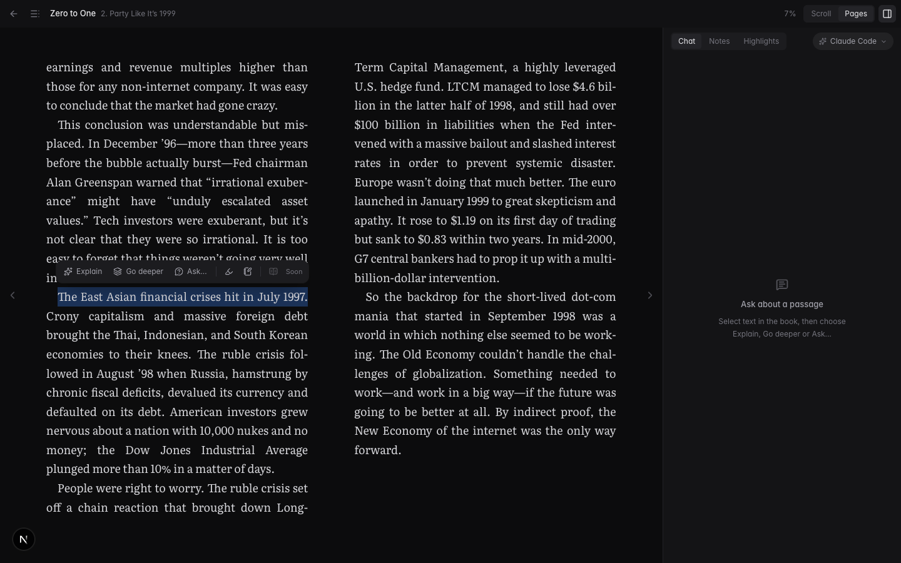
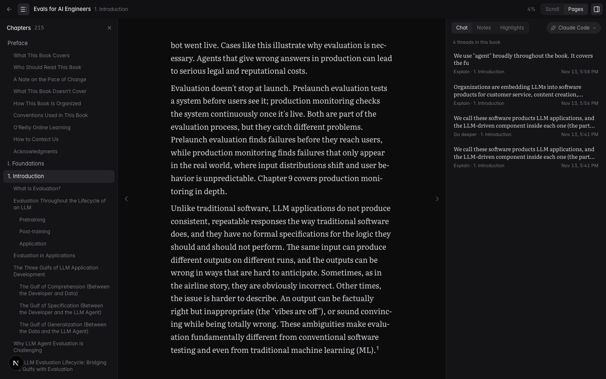
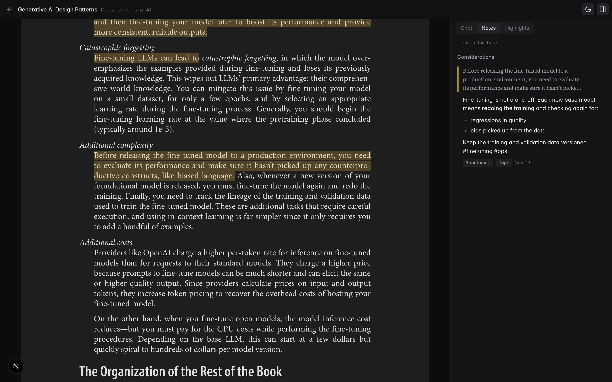

# rigg learn

Read your own EPUB and PDF books with an AI tutor beside you.

Select a passage and ask the tutor to explain it, go deeper, help you work it out, check your explanation, or answer a question. Highlight what matters. Write notes in markdown. Turn a passage into cards and review them when they're due. Everything you save is also copied to a markdown file, so your notes show up in Obsidian.

The app runs on your own computer. Your books stay there.




| Chapters beside the book | PDF with highlights and a note |
| --- | --- |
|  |  |


## What you need

- [Node.js 22](https://nodejs.org). Check with `node --version` in a terminal.
- A folder of EPUB or PDF books. Subfolders are fine.
- One tutor. See [Pick a tutor](#pick-a-tutor).

## Set it up

1. Open a terminal in this folder.

2. Install what the app needs.

   ```bash
   npm install
   ```

3. Make your own settings file from the example.

   ```bash
   cp .env.example .env.local
   ```

4. Open `.env.local` in a text editor. Put in the full path to your books folder. Paths start with `/`.

   ```bash
   BOOKS_DIR=/Users/you/Books
   NOTES_DIR=/Users/you/Obsidian/Reading
   ANTHROPIC_API_KEY=
   ```

You can also skip this step. With no `BOOKS_DIR`, the library page asks for your books folder, and for a notes folder if you want one. Choose them there, or change them later with **Folders** beside the Library heading. The app saves them in `data/settings.json`. A folder set in `.env.local` wins, and shows as read-only in the app with "Set in .env.local".

The app only reads your books folder. It never moves, renames or changes your books.

`.env.local` is private. Git ignores it, so your paths and key are never committed.

## Send your notes to Obsidian

Set `NOTES_DIR` to a folder inside your Obsidian vault, such as `Reading`. The app makes the folder if it is missing.

Each book gets one file, named after its title. Highlights sit under their chapter. Each one is a quote with a block id, so you can link to it from your other notes. A note sits under the quote it belongs to. Any `#tag` you write in a note is added to the file's tags.

```markdown
## Considerations

> and then fine-tuning your model later to boost its performance and provide more consistent, reliable outputs. ^h-c64781df

Fine-tuning only pays off once you have the data. #training
```

The file is a copy. The app writes it again after every change, so edits you make in Obsidian are replaced. Change highlights and notes in the app.

Leave `NOTES_DIR` empty if you don't want a copy. Everything is still saved in the app.

## Pick a tutor

The tutor can run through any one of these. You only need one.

- **Claude Code.** Install [Claude Code](https://claude.com/claude-code), then run `claude` in a terminal once and sign in. It uses your Claude plan.
- **Codex.** Install the Codex CLI, then run `codex login` in a terminal and sign in.
- **Anthropic API.** Put your key after `ANTHROPIC_API_KEY=` in `.env.local`. You pay per use.

Pick one from the tutor menu in the bar above the book, beside Scroll and Pages. The menu says which ones are ready, and what to do for the rest. The app remembers your choice, and the same tutor writes your cards.

## Start it

```bash
npm run dev
```

Then open [http://localhost:3000](http://localhost:3000). Your books are listed by folder, with their covers. The ones you read last sit under Continue reading. A bar under each book you've started shows how far you are.

Stop the app with `Ctrl+C` in the terminal.

## Mac app

The app puts the same reader in its own window, with a Dock icon and a native folder picker. It is built from this folder. It is not signed.

Build it:

```bash
npm run app:build
```

The disk image lands in `dist-app/`, as `rigg learn-0.1.0-arm64.dmg`. It is for Apple silicon Macs. Open it and drag rigg learn to Applications.

The first time, macOS says it can't verify the developer. Right-click the app and choose Open, then Open again. Or go to System Settings, then Privacy & Security, scroll down and choose Open Anyway.

How it works:

- The app starts its own copy of the server and stops it when you quit. If a rigg learn server is already running on port 3210, such as `npm run dev`, the app uses that one and leaves it running. If another program holds port 3210, the app tells you and quits.
- While the app is open, the browser at [http://localhost:3210](http://localhost:3210) shows the same books and notes. **Open in Browser** in the File menu opens it.
- The app keeps its data in `~/Library/Application Support/rigg learn/data`. To share it with `npm run dev`, start that with `DATA_DIR` set to the same full path.
- Closing the window leaves the app running, as on any Mac app. Quit with `⌘Q`.
- The app finds `claude` and `codex` the way your terminal does. For the API tutor, put `ANTHROPIC_API_KEY=` and your key in `~/Library/Application Support/rigg learn/.env`.
- If the app won't start, read `~/Library/Application Support/rigg learn/server.log`.

To try the app without making a disk image, run `npm run app:server` once, then `npm run app`.

## Read

- **Ask the tutor.** Select text. A small toolbar appears with Ask, Go deeper and Highlight; Note, Park a question and Make cards are behind the **⋯** button. Choose Ask and type a question, or press `Enter` on the empty field to have the passage explained. The answer is short. It may end with one **Your turn** question, shown as a prompt under the answer: take it, skip it with the ×, or just carry on. Pass over two in a session and no more appear until you open the app again.
- **Go deeper.** Select text and choose Go deeper. A sheet opens over the book and the passage is hidden. On a passage you have not asked about, the tutor writes one question for you to try first. On one you have, you are asked to explain it in your own words. Type your answer and press `Enter`. A separate checker grades it against the passage and shows right or not right, the first thing the answer missed, and the stretch of the passage that shows it. When the checker is not sure, it says so and leaves the call to you. One tap on **I had it** or **I missed it** overrules any grade. **Hint** gives one step at a time, up to four: where to think back to, what kind of idea it is, the idea itself, then the worked step. **Just tell me** gets the answer. `Esc` saves what you wrote and closes; the thread in the Chat tab opens the sheet again where you left it.
- **Older threads.** Threads started with Work it out or Explain it back, before those were folded into Ask and Go deeper, still open and carry on as they did.
- **Show the tutor an image.** Paste one with `⌘V`, drop it on the chat, or choose the image button in the message box. A message can carry up to 4 PNG, JPEG, WebP or GIF images. Ask about them, or send them alone and the tutor explains them. Images work in a follow-up on a passage, and in the box under the list of threads, where you can also ask about the book without selecting anything. Click an image in the chat to see it larger.
- **Highlight.** Select text and choose the highlighter, or press `⌘⇧H`. Click a highlight to remove it or open its note.
- **Write a note.** Select text and choose the notebook button. Notes are markdown. `⌘↩` saves.
- **Make cards.** Select text and choose the card button. The tutor picks one fact the passage supports and writes up to three questions on it. They show in the Cards tab, where you can edit or delete any of them. Making cards from the same passage again adds only new questions.
- **Review.** Choose Review in the Cards tab. Cards come up over the book, which keeps your place. Press `Space` to show the answer, then `1` to `4` for Again, Hard, Good or Easy. Each button shows when you'll see the card next. A card you miss comes back in a minute. Up to 10 new passages a day per book; due reviews have no cap. `Esc` closes.
- **Find them again.** The Notes, Highlights and Cards tabs list everything for the book. Click a quote to jump to it.
- **Chapters.** The list button at the top left, or `⌘⇧L`, opens the table of contents in a column beside the book. The book makes room for it and keeps your place. The chapter you're in is marked. Click any chapter to go there. In a narrow window the list slides over the book instead.
- **Scroll or pages.** Switch at the top right. Pages shows one page at a time, or two side by side in an EPUB when there's room. Turn pages with the arrow keys, `Page Up` and `Page Down`, or the arrows at the edges. Your place is kept when you switch, and the app remembers your choice.
- **Where you are.** A thin bar along the bottom of the book shows how far through it you are. Click or drag it to jump, or focus it and use the arrow keys. Under it are the page and the percent. An EPUB shows its printed page number when the book has one, and otherwise its location, a fixed slice of the text. In Pages view the middle says how many pages are left in the chapter, when the book's files make that clear.
- **Page colours.** In an EPUB, **Aa** at the top right switches between a dark page and a warm light one. Only the page changes; the app around it stays dark. Your place is kept. In a PDF, the moon at the top right shows white pages dark and the sun shows them in their own colours. Photos keep their colours.
- **Bold starts.** In an EPUB, choose Bold starts under **Aa** and the first letters of each word turn bold, in the style of Bionic Reading®. Some people find it helps them keep their place, but studies so far haven't found that it makes reading faster. Your place and your highlights stay put when you switch. Code is left alone, and so is Chinese, Japanese, Korean and Thai text.
- **Font.** **Aa** also lists the fonts on your Mac, each name in its own face, with a few faces made for reading at the top. Hover over a font, or move to it with the arrow keys, to see the book in it. Click it or press `Return` to keep it, or press `Esc` to go back. Reset to Literata returns to the default. Code stays in a monospaced face, and if a font you chose is removed from your Mac, the book goes back to Literata. PDFs keep their own fonts.
- **Speak instead of typing.** The mic button sits in the chat box and in the Ask and Park fields. Click it, talk, click it again. The words land where your cursor is, for you to fix before you send. `Esc` cancels. A recording can run up to 90 seconds. Transcription runs on your computer with the Parakeet TDT 0.6B v3 model, and no audio leaves it. The first time, the app asks before downloading the model, which is about 490 MB, and shows the progress. It is kept in a `models` folder beside the data folder (`~/Library/Application Support/rigg learn/models` for the Mac app, `./models` in a checkout), and it uses about 1.4 GB of memory while loaded. The Mac app asks for the microphone the first time you use it. Your browser asks too.
- **Park it.** Select text and choose the parking button, then type or dictate a question. It is saved with the passage and not sent to the tutor. A small note says it is parked, and the panel stays as it is. Parked questions wait at the top of the Chat tab. **Ask now** sends one to the tutor, the bin deletes it, and clicking the passage jumps there.
- **Where you left off.** When you open a book you have not read for half an hour, a small card shows the last few lines before your place and your latest highlights and notes in that chapter. **Recap** asks the tutor for a short recap of what came before your place, with nothing after it. The card goes away when you scroll, turn the page, press `Esc` or close it. A PDF shows the lines on your page when it has text there.
- **Spotlight.** In an EPUB, the focus button at the top right, or `⌘⇧F`, dims everything but the paragraph at your reading line and hides the top bar, the chapters column and the side panel. Click or select a paragraph to light it until you move. `Esc` or `⌘⇧F` leaves. It is off in a PDF for now, and it starts off each time.
- **Cards due.** Opening a book with cards to review shows a small "3 cards due" pill. Click it to start. It goes away when you start reading.
- **Time left.** In an EPUB, the line under the book says about how many minutes are left in the chapter, at 230 words a minute, when the chapter is one file.
- **More room.** `⌘\` hides or shows the side panel. `Esc` closes the toolbar.

A PDF made of scanned pictures has no text to select. You can still read it, but highlights, notes and the tutor need text.

## Where your data lives

| What | Where |
| --- | --- |
| Your books | The books folder: `BOOKS_DIR`, or the one you chose in the app. Never changed. |
| Reading place, chats and the one you had open, highlights, notes, and cards with when each is due | `data/<book id>.json`, one file per book |
| Your tutor choice, the books and notes folders you chose in the app, scroll or pages, the page colours for EPUBs and PDFs, bold starts, the book font, whether the chapters column is open, and which side panel tab you were on | `data/settings.json` |
| Book covers, made from each book the first time it's shown | `data/covers/`. Safe to delete; they're made again. |
| Images you show the tutor | `data/attachments/<book id>/`. Nothing deletes them yet, so images you removed before sending stay here too. |
| The speech model for voice input, downloaded the first time you use the mic | `models/`, beside the data folder. Safe to delete; it is downloaded again when asked. |
| What agents proposed and what you decided about each | `data/suggestions.json` |
| Every tool call an agent made: when, which tool, who called, a short form of the arguments, and how it went | `data/tool-log.jsonl`, one line per call. Lines are only added. Safe to delete. |
| The markdown copy of each book's highlights, notes and cards | `<notes folder>/<book title>.md`. The notes folder is `NOTES_DIR`, or the one you chose in the app. |

The `data/` folder is the real record. Git ignores it. Back it up if your notes matter to you.

`data/` sits in the folder you run the app from. Set `DATA_DIR` to a full path to keep it somewhere else, for example in `.env.local` or when starting the built server. The app reads `data/settings.json` from there, so `DATA_DIR` can't be set in the app.

## Two windows

You can have the same book open in two windows, say a browser tab and the Mac app. When you switch back to one, it shows what the other changed: your place, highlights, notes, cards, chats and settings. Your own changes never reload your window. Your place is saved the moment you leave a window, so the other one starts from there.

To use a different model, add it to `data/settings.json` under the tutor's name (`claude`, `codex` or `api`). For example, `"models": { "claude": "claude-opus-5-5" }`.

## Agents

Claude Code and Codex can use your library as tools: search your books, read a chapter, see your highlights, notes, tutor chats, Courses and whiteboards, and check what is due for review. The app doesn't need to be open.

```bash
npm run mcp:setup
```

That registers a server called `rigg-learn` with each of the two that is installed, for every project on this Mac (`claude mcp add --scope user` and `codex mcp add`). Run it again if you move this folder. Then ask in any Claude Code or Codex session, for example "which of my books explains attention, and what cards are due today?"

The server reads the same folders the app does: `DATA_DIR`, `BOOKS_DIR` and `NOTES_DIR` from `.env.local` in this folder, otherwise `./data` and the folders you chose in the app. To point it at the Mac app's data instead:

```bash
npm run mcp:setup -- --data-dir "$HOME/Library/Application Support/rigg learn/data"
```

What an agent can do:

| Tools | What they do |
| --- | --- |
| `list_library`, `get_book_text`, `search_library`, `list_annotations`, `list_threads`, `get_thread`, `review_queue`, `get_today`, `list_courses`, `list_boards`, `read_board`, `list_suggestions` | Read. Nothing changes. |
| `park_question`, `log_activity` | Write directly: a question left on a passage for you to ask later, and learning time added to today. |
| `propose_card` | Propose. The cards wait on the Today card with **Add** and **Reject**, and are only added when you accept. |
| `verify_item`, `grade_answer` | Ask a model and change nothing: check a written question against its passage before you see it, and grade a free-text answer, saying so when it is unsure. |

An agent can't change your highlights, notes, cards or boards any other way, and the server has no tool that reaches the web. Every call is written to `data/tool-log.jsonl`.

## What Phase 2 might add

Order, effort and what was rejected first: [roadmap.md](roadmap.md).

- Reading your Obsidian edits back into the app.
- Search across your books and notes.
- A light theme for the whole app. EPUB pages can already be light.

## How it works

It's a [Next.js](https://nextjs.org) app. The browser shows the books and the panel. A small server on your computer does everything that touches files or the tutor, so the browser never reads your disk or sees your key.

| Part | Where | What it does |
| --- | --- | --- |
| Library | `app/page.tsx`, `lib/server/library.ts` | Scans the books folder. Each book's id is a hash of its path, and files are only ever served by id. |
| EPUB reader | `components/reader/EpubReader.tsx` | Renders with [foliate-js](https://github.com/johnfactotum/foliate-js), kept in `public/vendor/foliate-js`. |
| Bold starts | `components/reader/fixations.ts` | Wraps the start of each word in an `rl-fx` element inside the book's page, splitting the text in place so your place doesn't move. foliate's CFI code in `public/vendor/foliate-js` is patched to skip those elements, so a highlight or reading place has the same address with bold starts on or off. |
| Fonts | `app/api/fonts/route.ts`, `lib/server/fonts.ts` | Lists the font families installed on this Mac, read once from the system's font list. The book sets the chosen family by name; no font files are served. |
| PDF reader | `components/reader/PdfReader.tsx` | Renders with [pdf.js](https://mozilla.github.io/pdf.js/), with its text layer so you can select. |
| Tutor | `app/api/chat/route.ts`, `lib/server/tutor/` | One adapter per tutor (Claude Code, Codex, API). Answers stream back to the panel. |
| Go deeper | `components/study/`, `lib/server/study.ts`, `app/api/books/[bookId]/study/route.ts` | The reader's turn on a passage, kept on its thread in the book's JSON: the question, each answer, its grade and any overrule. Grading is `gradeAnswer` on the checking model, apart from the tutor. |
| Images | `lib/client/images.ts`, `lib/server/attachments.ts` | The browser shrinks each image to 1568 px on its longest side before upload. The server reads its type from its bytes, not its name, and keeps it under a random id. |
| Folders | `lib/server/config.ts`, `components/library/FolderForm.tsx` | The environment first, then `data/settings.json`. The setup screen and the Folders button save to `PATCH /api/settings`, which accepts only a folder that exists. Inside the Mac app, `window.riggApp.pickFolder` opens a native picker. |
| Two windows | `components/book/useRefreshOnReturn.ts`, `app/api/books/[bookId]/revision/route.ts` | A window notes the book's revision (the saved state's and the settings' modified times) when it loses focus, and asks again when it returns. If it changed, the page refreshes. `/api/health` tells the Mac app that a server is already running. |
| Saving | `lib/server/store.ts`, `lib/server/file-lock.ts` | Writes `data/<book id>.json` safely: to a temp file first, one write at a time per book. A lock file beside each data file (`<file>.lock`) keeps that true when the app and an agent's server write at once; a lock left by a process that died is taken over. |
| Tools | `lib/server/tools/`, `lib/server/mcp/server.ts`, `scripts/mcp-server.mjs` | One list of tools, each with a name, a description, its input fields and a typed function. The fields make both the schema an agent reads and the check its arguments pass. The MCP server is that list over stdio; routes that do the same thing call the same functions. |
| Suggestions | `lib/server/suggestions.ts`, `components/courses/SuggestionInbox.tsx` | What agents propose is kept in `data/suggestions.json` until you decide. Accepting a card stores it through the same code the Cards button uses. |
| Obsidian copy | `lib/server/vault.ts` | Rewrites the book's markdown file after every highlight, note or card change. |
| Cards | `app/api/books/[bookId]/cards/route.ts`, `lib/server/cards/` | Sends the passage to the chosen tutor with the card prompt in `lib/server/cards/prompt.md`, outside any chat, and checks the JSON it returns. A bad reply goes back once with what was wrong. |
| Review schedule | `lib/shared/schedule.ts` | [FSRS](https://github.com/open-spaced-repetition/ts-fsrs) with 90 % retention. Each passage has one schedule; its questions take turns, the ones you rate lower more often. The study day starts at 04:00. |
| Covers | `lib/server/covers.ts` | Takes the cover from the EPUB, or draws page 1 of a PDF, and caches it. |

Claude Code and Codex run as separate programs with no tools turned on, in an empty temp folder, and with only a short list of environment variables. They can answer, but they can't read or change your files. Images reach Claude Code through its input, and Codex as copies in its temp folder that are deleted after each answer.

## For developers

```bash
npm test          # unit tests
npm run lint      # code style
npx tsc --noEmit  # type check
npm run build     # production build
```

## Credits

- [foliate-js](https://github.com/johnfactotum/foliate-js) by John Factotum, MIT licence. A copy is in `public/vendor/foliate-js` with its `LICENSE`.
- [pdf.js](https://github.com/mozilla/pdf.js) by Mozilla, Apache 2.0.
- [Literata](https://github.com/googlefonts/literata) for book text, [Inter](https://rsms.me/inter/) and [JetBrains Mono](https://www.jetbrains.com/lp/mono/) for the interface. All SIL Open Font Licence.

## Licence

MIT. See [LICENSE](LICENSE).
